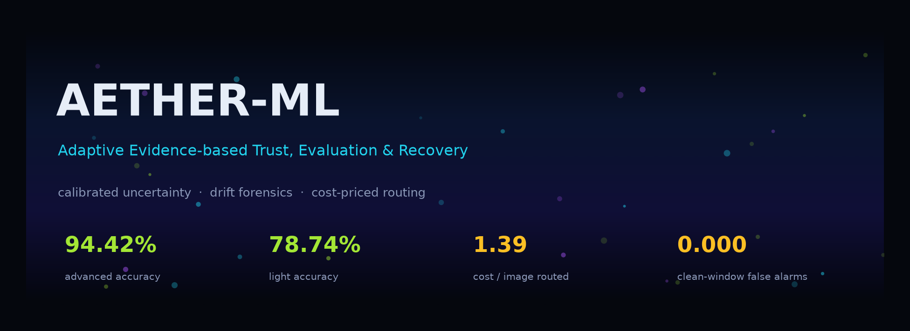

<p align="center">
  
  
  
  
  
</p>

**AETHER-ML** is a reliability layer for computer-vision inference. Every prediction ships with a
calibrated error probability, live drift evidence, and a routing decision — answer with the fast
model, escalate to the strong one, send it to a human, or refuse. No vibes-based routing. Receipts,
not claims.

> **the flex, in four numbers**
> `94.42%` accuracy from the escalation tier · `65.3%` of traffic answered at `93.82%` accuracy ·
> `1.39` expected cost per image vs `2.54` for always-strong · `0.000` false alarms on clean drift windows.
> All measured on this machine, on splits that were never used for tuning.

---

## the problem

A model in production fails in two ways accuracy cannot describe: it is **confidently wrong**, and it
**silently decays** when the world shifts. A single number on a leaderboard tells you neither. So
AETHER treats each prediction as evidence gathering — uncertainty, input quality, distribution shift
and cross-model disagreement — fuses that evidence into a calibrated `P(wrong)`, prices every
possible action against explicit costs, and emits the decision *with its justification attached*.

The fleet is deliberately two-tier: a **MobileNetV3-Small** that eats the easy 65 %, and a
**ResNet50** that gets paid for only when the economics say it is worth it.

## what it actually does

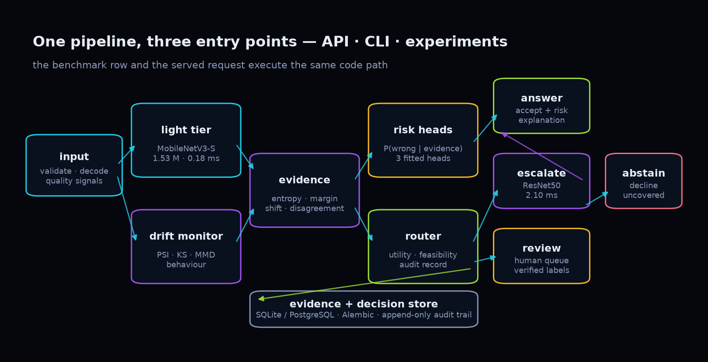

One `ReliabilityPipeline` object drives the API, the CLI and the offline experiments. A benchmark row
and a served request execute the same code path — there is no second implementation to drift out of
sync.

```text
image → validate/decode → light inference → calibrate → uncertainty
      → drift tests (PSI · KS · MMD · behaviour) → risk heads
      → router: ACCEPT | ESCALATE → re-decide | HUMAN_REVIEW | ABSTAIN
      → evidence + decision + audit record (SQLite / PostgreSQL)
```

## the receipts

CPU only — 8 threads, torch `2.13.0+cpu`, numpy `2.5.2`, Python `3.12.3`, seed 42. Official CIFAR-10
test split, 10,000 images, pixel fingerprint `f9b1e2130bab680d`. Regenerate everything with
`make benchmarks && make figures`.

### tier head-to-head

| model | params | accuracy | macro F1 | ECE ↓ | Brier ↓ | NLL ↓ | AURC ↓ | latency |
| --- | --- | --- | --- | --- | --- | --- | --- | --- |
| **lightweight** · MobileNetV3-Small | 1.53 M | 0.7874 | 0.7879 | 0.0218 | 0.3018 | 0.6319 | 0.0677 | 0.18 ms |
| **advanced** · ResNet50 | 23.53 M | 0.9442 | 0.9440 | 0.0131 | 0.0893 | 0.2029 | 0.0119 | 2.10 ms |

15.4× the parameters buys 15.7 accuracy points and 11.6× the latency. That gap is exactly why
routing exists.

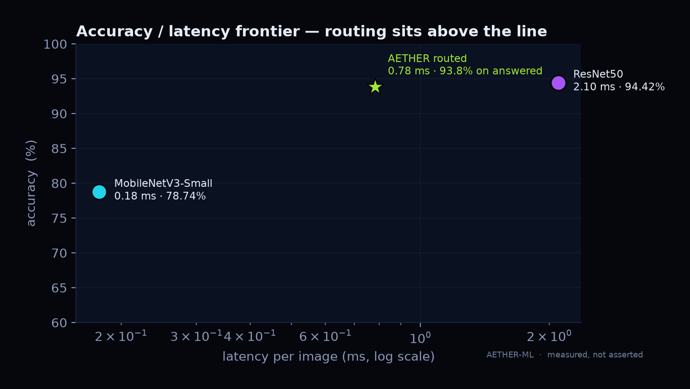

### calibration is the cheat code

One temperature per model, fitted on a dedicated 4,000-sample split. That is it. No architecture
change, no retraining, no extra parameters at inference.

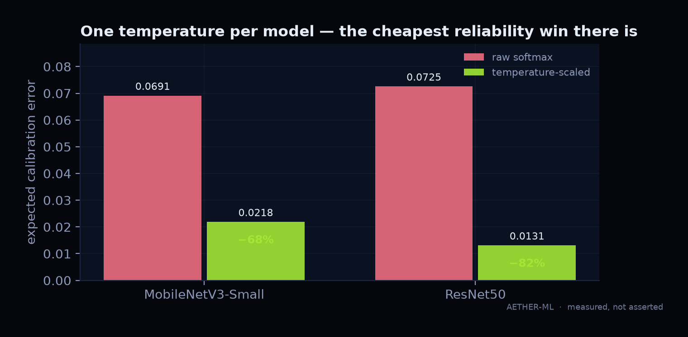

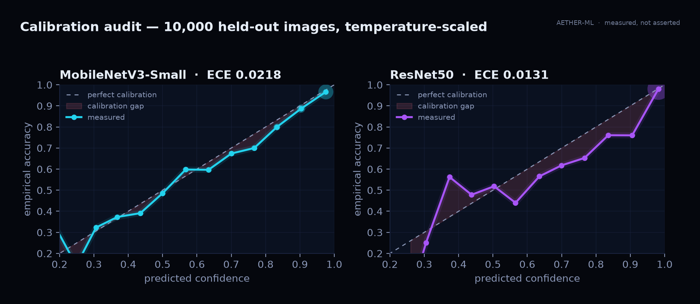

| model | temperature | ECE raw softmax | ECE calibrated | reduction |
| --- | --- | --- | --- | --- |
| lightweight | 0.7527 | 0.0691 | 0.0218 | 68.5 % |
| advanced | 0.7055 | 0.0725 | 0.0131 | 81.9 % |

### abstention is a feature

Rank by confidence, answer the top slice, refuse the rest. At 50 % coverage the light tier's error
rate drops from 21.3 % to 4.5 %; the strong tier's from 5.6 % to 0.8 %.

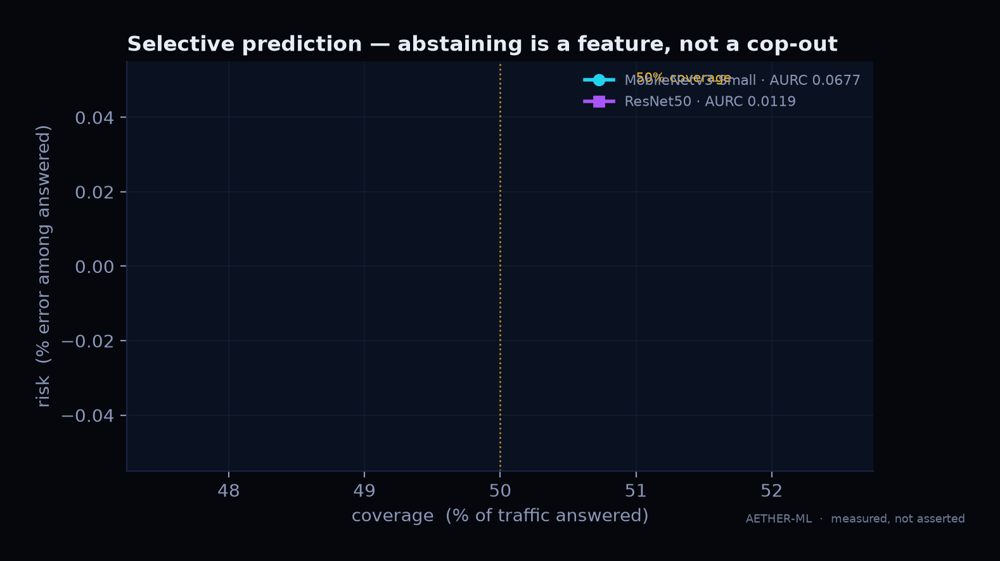

| coverage | light risk | advanced risk |
| --- | --- | --- |
| 50 % | 0.0446 | 0.0078 |
| 70 % | 0.0970 | 0.0094 |
| 80 % | 0.1315 | 0.0115 |
| 90 % | 0.1661 | 0.0224 |
| 100 % | 0.2126 | 0.0558 |

### corruption sweep — 10 families × 5 severities

2,500 stratified images per condition. The light tier loses 26 points of accuracy on average; the
strong tier loses 25 — robustness is *not* something scale hands you for free.

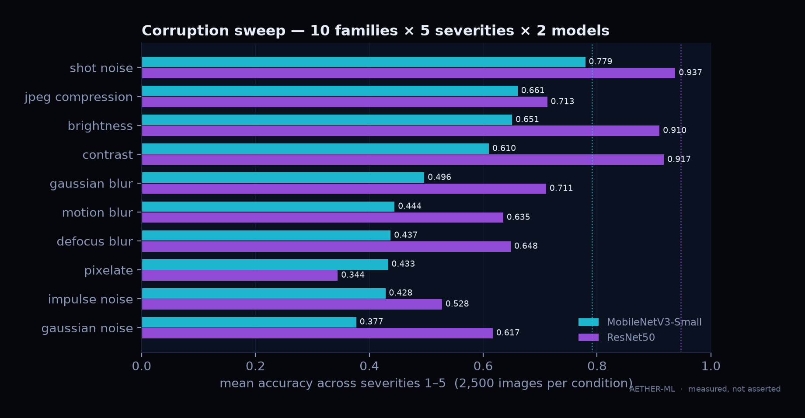

| tier | clean | mean corrupted | worst corrupted | mean corrupted ECE |
| --- | --- | --- | --- | --- |
| lightweight | 0.7916 | 0.5318 | 0.2108 (gaussian noise, sev 5) | 0.1622 |
| advanced | 0.9468 | 0.6961 | 0.1904 (pixelate, sev 5) | 0.1312 |

Pixelate breaks the strong model harder than noise does — a genuinely useful thing to know before
you deploy to a CDN that re-encodes images.

### drift forensics

PSI on input statistics, per-component KS + permutation MMD on embeddings, KS/χ² on prediction
behaviour — Bonferroni-combined into one score with bands at 1.5 / 3.0 / 6.0, measured over
200-image windows.

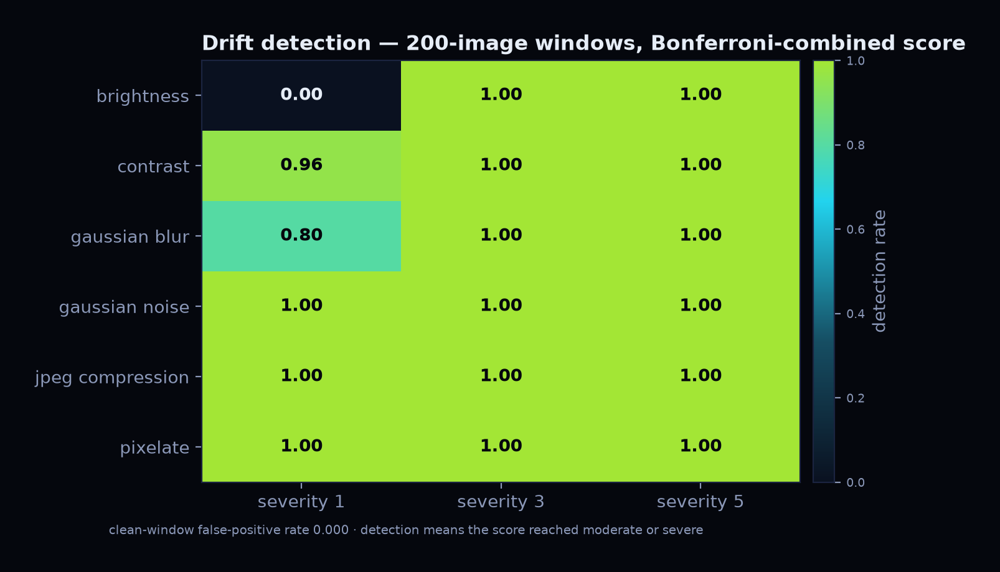

| condition | detection rate |
| --- | --- |
| clean development windows (false positives) | **0.000** |
| severity 1 | 0.793 |
| severity 3 | 1.000 |
| severity 5 | 1.000 |

Detection means *the input distribution moved*. It does **not** mean accuracy dropped — labels are
absent in production, and AETHER never pretends otherwise.

### routing — the money shot

6,000-image replay (5,000 clean + 3,000 corrupted routing-dev samples). Costs are relative units:
error 10, escalate 1, review 4, abstain 2.

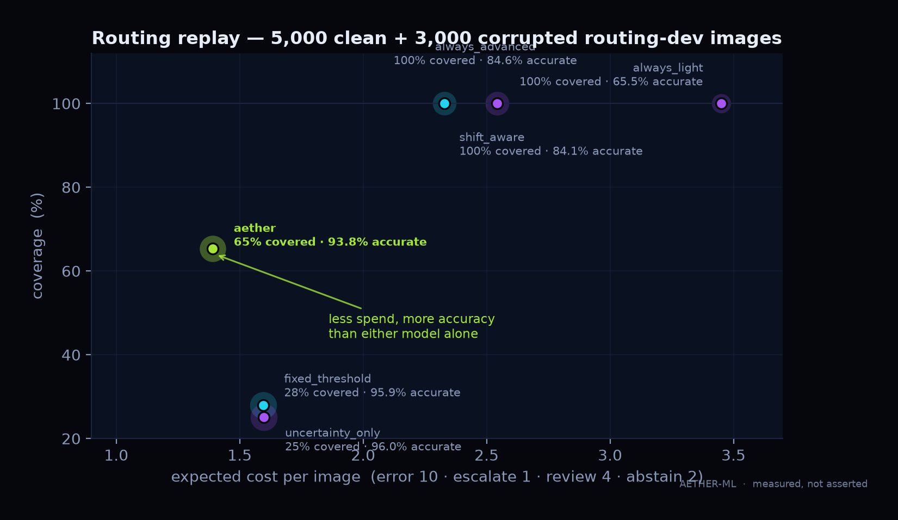

| policy | coverage | acc on answered | escalated | abstain | ms/img | cost/img |
| --- | --- | --- | --- | --- | --- | --- |
| always_light | 1.000 | 0.6550 | 0.000 | 0.000 | 0.18 | 3.450 |
| always_advanced | 1.000 | 0.8456 | 0.000 | 0.000 | 2.05 | 2.544 |
| fixed_threshold | 0.279 | 0.9588 | 0.741 | 0.721 | 0.26 | 1.594 |
| uncertainty_only | 0.251 | 0.9602 | 0.000 | 0.749 | 0.18 | 1.598 |
| shift_aware | 1.000 | 0.8413 | 0.741 | 0.000 | 1.70 | 2.328 |
| **AETHER** | **0.653** | **0.9382** | 0.316 | 0.347 | 0.78 | **1.390** |

Read it like this: AETHER answers two-thirds of a deliberately ugly stream at 93.82 % accuracy —
28 points above the model it runs on — for 45 % less than always using the strong model, and it
declines the third it cannot vouch for instead of guessing. An abstention is charged its cost and
counted as **uncovered**, never as wrong.

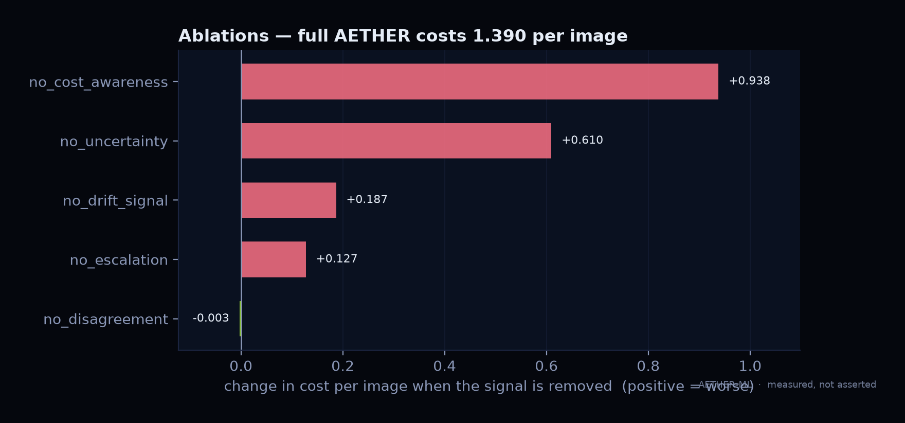

| variant | coverage | acc on answered | cost/img | Δ vs full |
| --- | --- | --- | --- | --- |
| no_uncertainty | 0.000 | — | 2.000 | +0.610 |
| no_drift_signal | 0.867 | 0.9056 | 1.577 | +0.187 |
| no_cost_awareness | 1.000 | 0.8413 | 2.328 | +0.938 |
| no_disagreement | 0.652 | 0.9387 | 1.387 | −0.003 |
| no_escalation | 0.481 | 0.9002 | 1.518 | +0.128 |
| clean_only_subset* | 0.963 | 0.9460 | 1.062 | different stream |

\* clean-only evaluation, shown for context; its cost is not comparable to the mixed-stream rows.

Removing cost-awareness is the most expensive mistake you can make — it costs almost a full unit per
image. Removing drift signal is cheap on this stream and hides its value; drift only earns its keep
when the world actually moves.

### the risk heads

Three logistic heads, three jobs. All fitted on the **calibration** split; the routing-dev split is
reserved for evaluating policies, never for fitting them.

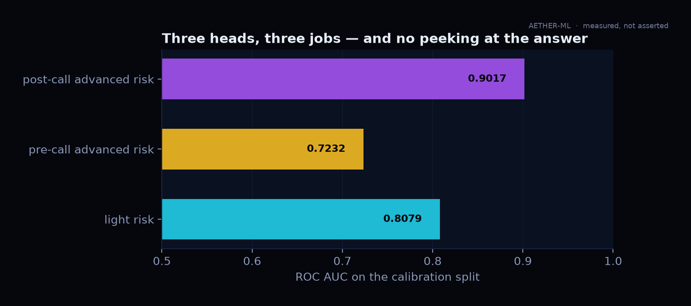

| head | evidence available | predicts | ROC AUC |
| --- | --- | --- | --- |
| lightweight | first call | light tier wrong | 0.8079 |
| **pre-call advanced** | first call | strong tier wrong | 0.7232 |
| advanced | after second call | strong tier wrong | 0.9017 |

The pre-call head is the honest one: it prices escalation from evidence that exists **before** the
second call is paid for. Mean predicted risk reduction across escalations: `0.1525`.

### confusion, side by side

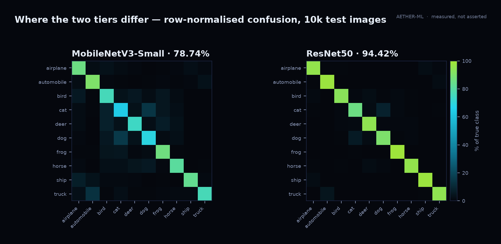

Cat ↔ dog is the expensive confusion in both tiers; the strong model mostly fixes ship ↔ airplane
and automobile ↔ truck.

## the theory

### 1 · temperature scaling

$$
p_i = \mathrm{softmax}\!\left(\frac{z_i}{T}\right), \qquad
T^{\star} = \arg\min_T \; -\sum_{n=1}^{N} \log p_{y_n}(x_n; T)
$$

Fitted on the calibration split only. `T > 1` softens an overconfident model; `T < 1` sharpens an
underconfident one. Both tiers here land below 1 (`0.75`, `0.71`) — they were *under*confident at
64 px.

### 2 · uncertainty features

$$
H(p) = -\sum_k p_k \log p_k, \qquad
\tilde{H}(p) = \frac{H(p)}{\log K}, \qquad
\mathrm{MSP} = \max_k p_k, \qquad
m = p_{(1)} - p_{(2)}
$$

Entropy is the base signal, normalised entropy makes it comparable across label spaces, MSP and
margin capture the geometry near the decision boundary.

### 3 · calibration error

$$
\mathrm{ECE} = \sum_{b=1}^{B} \frac{|B_b|}{N}\,\bigl|\,\mathrm{acc}(B_b) - \mathrm{conf}(B_b)\,\bigr|
$$

15 equal-width confidence bins. ECE is reported, never optimised directly — optimising ECE is how
you get a well-calibrated model that is still wrong in the same places.

### 4 · selective risk

Rank by confidence, accept the top `c` fraction:

$$
\mathrm{risk}(c) = \mathbb{P}\bigl(\hat{y} \neq y \mid \text{confidence} \ge \tau_c\bigr),
\qquad
\mathrm{AURC} = \int_0^1 \mathrm{risk}(c)\,dc
$$

Lower AURC means the model knows what it does not know. This is the metric that matters for
abstention-based systems, and it is reported for both tiers.

### 5 · drift composite

$$
S = \max\Bigl(\;\mathrm{PSI}_{\text{input}},\;
\max_j \mathrm{KS}_{j}^{\text{embedding}},\;
\mathrm{MMD}^2_{\text{perm}},\;
\chi^2_{\text{behaviour}}\Bigr),
\qquad
p_{\text{adj}} = \min\bigl(1,\; m \cdot p_{\min}\bigr)
$$

The KS statistics are Bonferroni-corrected across the PCA components actually tested, so a lucky
component cannot fake a drift alert. Bands: `none < 1.5 ≤ low < 3.0 ≤ moderate < 6.0 ≤ severe`.
A clean window scores 0.22 on average here; a severity-3 corruption crosses the moderate band every
time.

### 6 · risk model

$$
P(\text{wrong} \mid x) = \sigma\!\left(w^\top \phi(x) + b\right),
\qquad
\phi(x) = [\,H,\ \mathrm{MSP},\ m,\ \mathbf{1}_{\text{shift}},\, \mathbf{1}_{\text{disagree}}\,]
$$

Fitted with L2-regularised logistic regression on the calibration split. The first-call and pre-call
heads exclude disagreement — it does not exist before a second model runs, and including it would
leak the escalation's own outcome. Drift score is excluded everywhere: development data has only two
drift levels, so its coefficient is not identified.

### 7 · routing utility

$$
\begin{aligned}
U_{\text{accept}}   &= (1-r_l)\,c_{\text{correct}} - r_l\,c_{\text{error}} \\
U_{\text{escalate}} &= (1-r_a)\,c_{\text{correct}} - r_a\,c_{\text{error}} - c_{\text{escalate}} \\
U_{\text{review}}   &= (1-r_l\rho)\,c_{\text{correct}} - (r_l\rho)\,c_{\text{error}} - c_{\text{review}} \\
U_{\text{abstain}}  &= -c_{\text{abstain}}
\end{aligned}
$$

Feasibility is applied **before** utility: escalation is removed when the escalation cap is spent,
the model is missing, or the latency budget cannot absorb the measured latency. An over-budget answer
is a failure, not a slow success. After the second call has actually run, ACCEPT and HUMAN_REVIEW are
priced with the **measured** advanced risk — otherwise the router pays for an answer and then
declines to use it.

### 8 · the honest bit

A pre-call estimate of the strong model's error is not free information: AUC 0.72 is a real signal but
a weak one. Occasionally AETHER pays for escalation and then still abstains, because the strong model
turned out to be less certain than the estimate implied. That is visible in the cost column, and it is
the correct behaviour — the alternative is to force an answer the evidence does not support.

## stability — guarantees, not optimism

Two additions that turn reliability claims into checkable ones.

### conformal acceptance

Temperature scaling makes a probability honest; split conformal makes the **acceptance threshold**
honest. Scores on the calibration split (`1 − p(true class)`) give a threshold whose selective error
is bounded at `alpha` with finite-sample confidence — no distributional assumption beyond
exchangeability between calibration and served traffic.

| tier | alpha | threshold | coverage (clean) | selective error |
| --- | --- | --- | --- | --- |
| lightweight | 0.20 | 0.395 | 0.953 | 0.192 |
| lightweight | 0.10 | 0.144 | 1.000 | 0.210 |
| lightweight | 0.05 | 0.053 | 1.000 | 0.210 |
| lightweight | 0.02 | 0.019 | 1.000 | 0.210 |
| advanced | 0.20 | 0.971 | 0.808 | 0.013 |
| advanced | 0.10 | 0.901 | 0.904 | 0.028 |
| advanced | 0.05 | 0.466 | 0.993 | 0.061 |
| advanced | 0.02 | 0.031 | 1.000 | 0.067 |

Tighter guarantees cost coverage, exactly as they should. The bound is marginal over draws, and it
does **not** survive distribution shift — the corrupted-stream columns live in
[`artifacts/reports/STABILITY.md`](artifacts/reports/STABILITY.md) rather than being quietly folded
into the clean numbers.

### test-time augmentation (opt-in)

| stream | identity | with mirror TTA | delta | extra pass |
| --- | --- | --- | --- | --- |
| clean routing-dev | 0.9335 | 0.9435 | +0.0100 | 2.44 ms |
| gaussian noise, severity 3 | 0.6350 | 0.6450 | +0.0100 | 2.56 ms |

Averaging the mirror costs one extra advanced forward pass (2.44 ms per image) and moves accuracy by +0.0100 clean and +0.0100 under corruption. It is therefore **opt-in** via `routing.tta: true` — measured, not assumed to help, and not enabled by default while it doubles escalation spend for a marginal gain.

Both are reproduced by `make stability`; the pipeline totals are unchanged unless TTA is enabled.

## efficiency — what it costs

Measured by `make efficiency` on the same CPU that produced every other number here, warmed, with
medians across interleaved rounds. Raw data: [`artifacts/reports/EFFICIENCY.md`](artifacts/reports/EFFICIENCY.md).

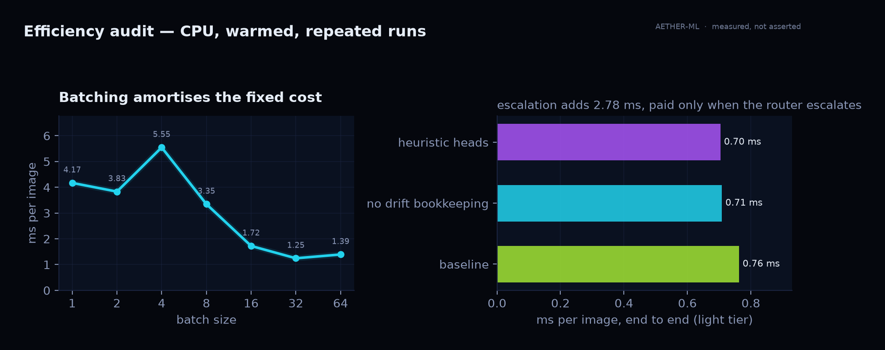

### steady state, per image

| stage | cost |
| --- | --- |
| image quality analysis | 0.151 ms |
| preprocess (resize / normalise) | 0.071 ms |
| lightweight inference | 0.611 ms |
| calibrate + uncertainty | 0.032 ms |
| temperature lookup (cached) | 0.009 ms |
| risk features | 0.0006 ms |
| two risk heads | 0.008 ms |
| drift bookkeeping | 0.0002 ms |
| routing decision | 0.020 ms |
| **end to end (light tier)** | **0.76 ms** |

Inference is 80 % of the budget. Everything AETHER adds — calibration, drift, two risk heads,
utility routing, explanation — is under 0.15 ms, roughly one fifth of a single forward pass.

### batching

| batch | ms / image | images / s |
| --- | --- | --- |
| 1 | 4.17 | 240 |
| 8 | 3.35 | 299 |
| 16 | 1.72 | 580 |
| 32 | 1.25 | 803 |
| 64 | 1.39 | 718 |

Throughput rises 3.3× from batch 1 to 32 and then flattens — the fixed per-request cost is amortised,
and beyond 32 the CPU kernels are saturated. Batch 1 is the honest interactive number.

### what each capability costs

| capability | marginal cost | when it is paid |
| --- | --- | --- |
| drift bookkeeping | +0.054 ms/image | every request |
| learned heads vs heuristic | +0.059 ms/image | every request |
| composite drift evaluation | 197 ms per 200-image window → **+0.99 ms/image amortised** | once per window |
| escalation (ResNet50) | **+2.78 ms** | only escalated images |
| durable write (3 rows) | 9.8 ms/prediction | every persisted request |

The composite score is the expensive optional feature — permutation MMD plus 32 KS tests — which is
exactly why it runs per window instead of per request. The durable write is now the dominant cost at
these latencies, which is why the API writes a batch in one transaction.

### memory

RSS grew **0.2 MB across 320 predictions**; the drift window is bounded at 200 observations and held
exactly 200 after 320 predictions. Memory is flat by construction, not by luck.

### what this pass fixed

| issue | fix | evidence |
| --- | --- | --- |
| calibration JSON re-read and re-parsed on **every prediction** (0.057 ms median per call) | cached by artifact mtime + size | regression test counts reads: once per version |
| risk feature vector built twice per image (light + pre-call heads) | built once, scored by both heads | identical AUCs on the calibration artifact |
| drift bookkeeping recomputed entropy and max-probability | reuses the calibrated values | same window contents, less work |
| per-image channel-mean loop in the hot path | one vectorised reduction per batch | batch behaviour unchanged |
| advanced-checkpoint `exists()` stat on every batch | cached at construction | one stat per process |


## the console

Eight pages, one source of truth: every figure on screen is read from an artifact or from the
database, never hardcoded.

<table>
<tr>
<td width="50%">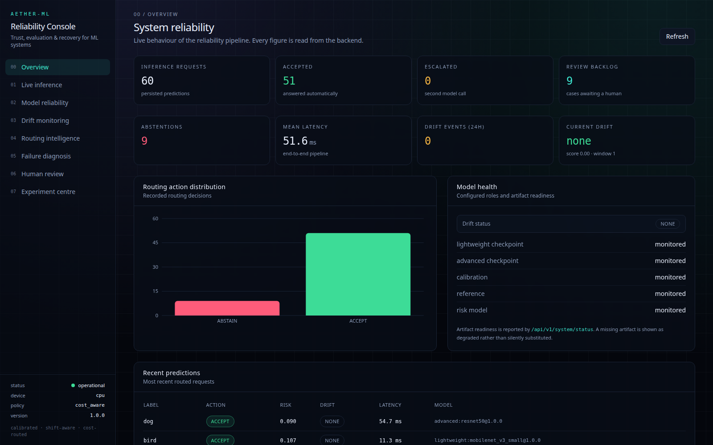</td>
<td width="50%">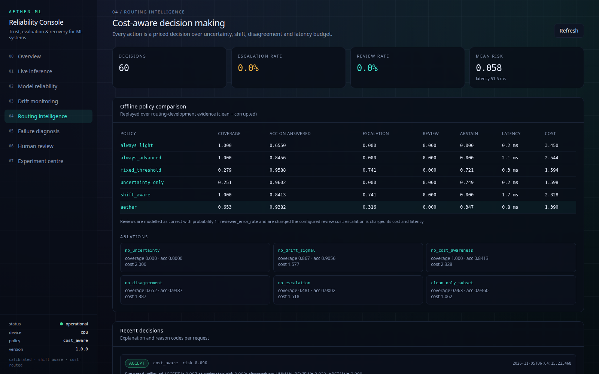</td>
</tr>
<tr>
<td>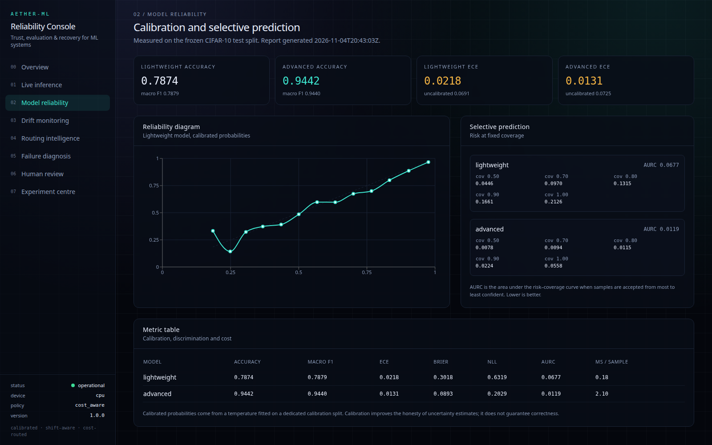</td>
<td>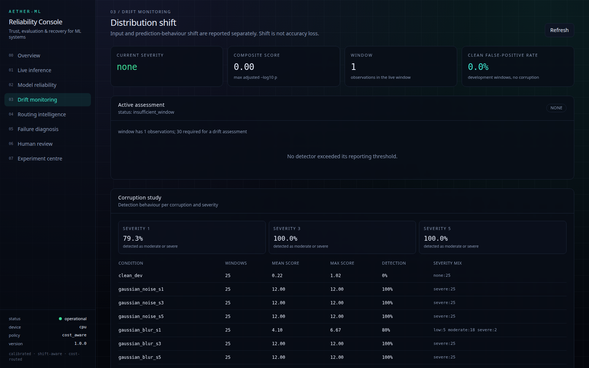</td>
</tr>
<tr>
<td>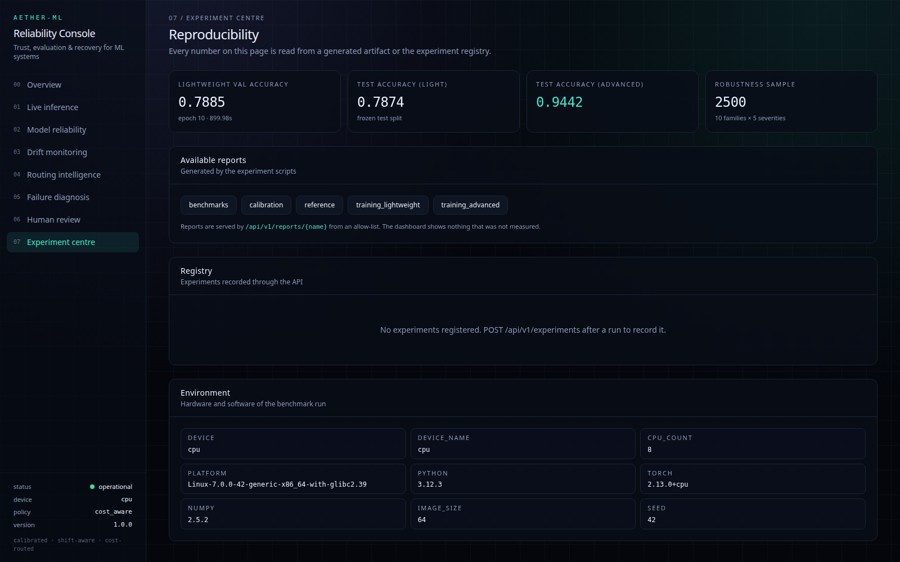</td>
<td>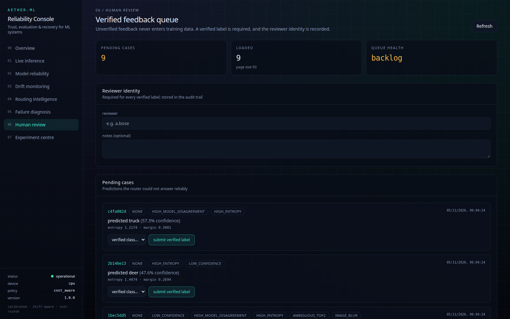</td>
</tr>
</table>

## stack

| layer | technology |
| --- | --- |
| core | Python 3.11+, NumPy, SciPy, scikit-learn, PyTorch |
| serving | FastAPI, SQLAlchemy 2, Alembic, SQLite / PostgreSQL |
| dashboard | React 18, TypeScript, Vite, recharts, Tailwind |
| ops | Docker Compose, nginx, GitHub Actions |
| quality | pytest (113 passing), ruff clean, mypy clean over `aether/` (52 modules) |

## quickstart

```bash
git clone https://github.com/officialarghya29/AETHER.git && cd AETHER
python -m venv .venv && source .venv/bin/activate
pip install -e ".[dev]"

make data        # materialise CIFAR-10 into data/raw (never committed)
make train       # fine-tune both tiers        ~60 min CPU
make calibrate   # temperatures + the three risk heads
make reference   # freeze the drift reference window
make benchmarks  # full reliability study
make efficiency  # latency, throughput and per-capability cost
make figures     # render every chart in this README from the recorded results
```

Serve it:

```bash
make migrate     # create the schema
make api         # http://localhost:8000/docs
make frontend    # http://localhost:5173
```

Or the whole stack: `make docker-up`. Single shot from the terminal:

```bash
aether status
aether predict path/to/image.png --json
```

## api surface

All routes live under `/api/v1`.

| method | path | purpose |
| --- | --- | --- |
| `GET` | `/health` | liveness, model and drift availability |
| `GET` | `/system/status` | runtime, artifact and database state |
| `POST` | `/predict` | one image → prediction, uncertainty, decision, evidence |
| `POST` | `/predict/batch` | bounded batch with per-item routing |
| `GET` | `/predictions/{id}/uncertainty` | full uncertainty breakdown |
| `GET` | `/diagnostics/{id}` | why this decision was taken |
| `GET` | `/drift/status`, `/drift/events` | live drift state and history |
| `GET` | `/routing/metrics` | action mix, escalation and abstention rates |
| `GET`/`POST` | `/reviews`, `/feedback` | human verification queue and labelled feedback |
| `GET` | `/reports/{name}` | allow-listed generated benchmark artifacts |

Interactive schema at `/docs`; design notes in [`docs/API.md`](docs/API.md).

## reproducibility contract

```text
train 32,000 · validation 4,000 · calibration 4,000 · routing_dev 5,000 · holdout 5,000
official test 10,000 — reported only, never tuned
```

- temperatures fitted on `calibration`
- risk heads fitted on `calibration`, evaluated on `routing_dev`
- routing thresholds and drift bands chosen on `routing_dev`
- drift reference frozen from `holdout`
- the test split is touched once, for the numbers above

Splits are persisted with a SHA-256 fingerprint of the pixel arrays, so "same split" is checkable,
not a promise.

## what's real, what's not

**Real and reproduced here:** training, calibration, drift study, routing replay, ablations, API,
dashboard, container images, test suite.

**Implemented but not exercised in this environment:** the compose stack against PostgreSQL (images
build and the API runs against SQLite), and the GitHub Actions workflow (written, not run on Actions).

**Out of scope, stated plainly:** natural-resolution imagery, adversarial robustness, a real human
reviewer study (2 % residual error is assumed), label-free accuracy guarantees from drift alone, and
5 of the 15 CIFAR-10-C corruption families.

## docs

| document | contents |
| --- | --- |
| [`docs/PRD.md`](docs/PRD.md) | problem, users, scope, success criteria |
| [`docs/SRS.md`](docs/SRS.md) | numbered functional and non-functional requirements |
| [`docs/TDD.md`](docs/TDD.md) | module contracts and test strategy |
| [`docs/ARCHITECTURE.md`](docs/ARCHITECTURE.md) | components, data flow, deployment topology |
| [`docs/ALGORITHMS.md`](docs/ALGORITHMS.md) | uncertainty, drift, risk and routing mathematics |
| [`docs/EXPERIMENTS.md`](docs/EXPERIMENTS.md) | protocol, splits, seeds, how to reproduce |
| [`docs/DECISIONS.md`](docs/DECISIONS.md) | architecture decision records |
| [`docs/SECURITY.md`](docs/SECURITY.md) | threat model and controls |
| [`docs/DEPLOYMENT.md`](docs/DEPLOYMENT.md) | local, container and production paths |
| [`docs/IMPLEMENTATION_STATUS.md`](docs/IMPLEMENTATION_STATUS.md) | what is built, verified, or planned |

## license

**Proprietary — all rights reserved.** Copyright © 2026 Arghya Bose. This repository is not open
source: no use, copying, modification, distribution, or derivative work is permitted without prior
written consent. See [`LICENSE`](LICENSE).
